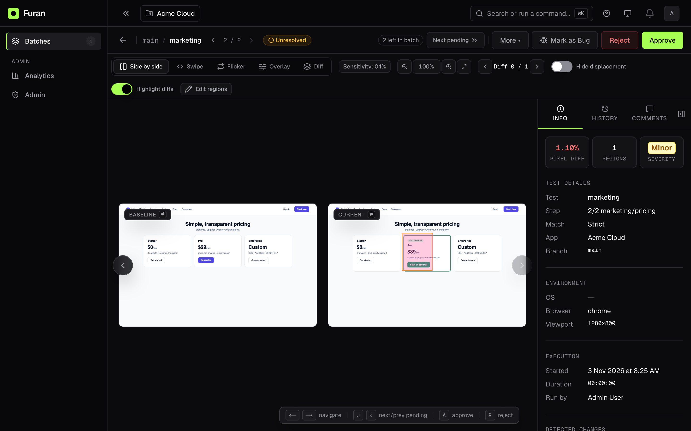
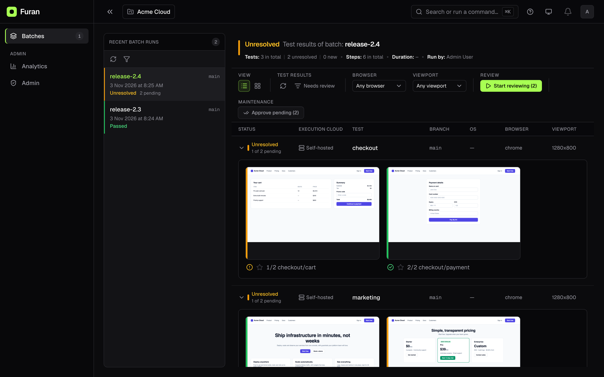
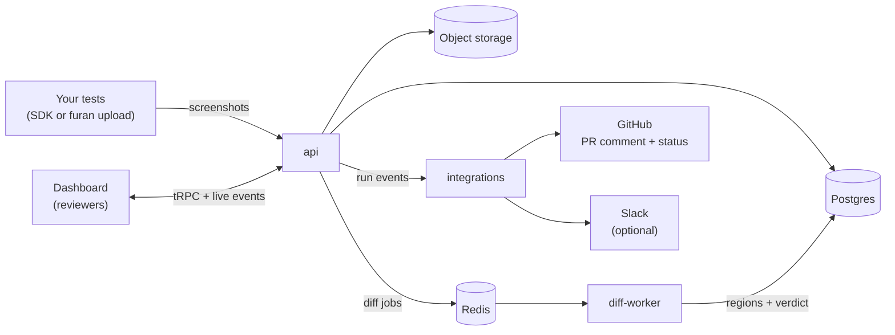

<div align="center">


# Furan

**Self-hosted visual regression testing for teams that ship.**

Capture screenshots in CI, compare them against an approved baseline, and review
every pixel change in a fast dashboard, on infrastructure you control.

[](https://hub.docker.com/u/qasecret)
[](https://github.com/qasecret/furan-monorepo/actions/workflows/ci.yml)
[](https://central.sonatype.com/namespace/io.github.qasecret)
[](https://www.npmjs.com/package/@furan/cli)
[](LICENSE)
[](#-security)

[**Quick start**](#-quick-start) ·
[**Documentation**](https://furan-monorepo.rabindrabiswal404.workers.dev) ·
[**SDKs**](#-sdks-and-integrations) ·
[**Architecture**](ARCHITECTURE.md) ·
[**Changelog**](CHANGELOG.md) ·
[**Contributing**](CONTRIBUTING.md)

<br>



</div>

## Why Furan?

- **Self-hosted, end to end.** Screenshots, baselines, and review history stay on your servers. No SaaS account and no data leaving your network.
- **No per-screenshot pricing.** Run as many checkpoints as your CI can produce. Your only cost is the host.
- **No telemetry, no feature gates.** Apache 2.0, with every feature in the open-source build.
- **Up in one command.** A single compose file runs the whole stack, with migrations applied for you.
- **Fits the tests you already have.** JUnit 5 with Selenium, Playwright, or Appium; Node with Playwright Test or Cypress; or any tool that writes PNG files.

<details>
<summary><strong>Table of contents</strong></summary>

- [Why Furan?](#why-furan)
- [Features](#-features)
- [Quick start](#-quick-start)
- [Send your first screenshot](#-send-your-first-screenshot)
- [SDKs and integrations](#-sdks-and-integrations)
- [How it works](#-how-it-works)
- [Is Furan for you?](#-is-furan-for-you)
- [Documentation](#-documentation)
- [Roadmap](#-roadmap)
- [Security](#-security)
- [Getting help](#-getting-help)
- [Contributing](#-contributing)
- [License](#-license)

</details>

## ✨ Features

**Diffing**

- **Image-first pipeline.** The rendered screenshot is the source of truth. Choose a pixel engine per project (`odiff`, `pixelmatch`, or `looks-same`), with global-shift alignment and per-region severity scoring.
- **Visual-AI layer (optional).** When a pixel diff is found, a vision model (Ollama, Gemini, or Anthropic) explains what changed in plain language. Pixel checks always run first, so identical images never reach the model.
- **Accessibility pass (optional).** An `axe-core` scan reports WCAG violations as regions on the same checkpoint.

**Review**

- **Diff viewer** with five comparison modes (side by side, swipe, flicker, overlay, diff), keyboard navigation through changed regions, and inline review comments.
- **Review loop** that walks every pending checkpoint (`J` / `K`, a command palette, undo), so a batch of changes takes minutes rather than an afternoon.
- **Element-anchored ignore regions.** Draw a mask over an element and the SDK records its CSS selector, so the mask follows the element through layout changes.
- **Dynamic text regions.** Regex-matched OCR regions mask dates and order numbers only when the text matches, so real layout changes underneath still surface.
- **Auto-rules** that resolve known, expected changes, so a recurring diff stops failing the run.

**Workflow**

- **Branch-aware baselines.** A feature branch falls back to its pull request's base branch, then the default branch, so feature work never pollutes `main`'s baselines.
- **GitHub App** with a sticky pull request comment and a `furan/baselines` status check, plus optional Slack notifications through an incoming webhook.
- **CI-native verdicts.** The SDKs and `furan upload` wait for the result and fail the job when a screenshot needs review.

**Operations and security**

- **Role-based access control** with four tiers (owner, admin, editor, guest), an admin audit log, and an opt-in Postgres [row-level-security backstop](docs/runbooks/rls-enable.md).
- **Production-ready images.** Multi-arch (amd64 / arm64), cosign-signed, Trivy-scanned, with an SBOM attached to every release.
- **Flexible storage.** S3-compatible object storage (MinIO included) or plain local disk.
- **Observability.** Prometheus `/metrics`, OpenTelemetry tracing, structured logs, retention policies, and a nightly Postgres backup sidecar.
- **OpenAPI 3.1** spec at `GET /openapi.json`, with an interactive API reference at `/api/docs`.

<p align="center">
  
</p>

## 🚀 Quick start

You need Docker 24 or later with Compose v2, about 4 GB of free RAM, and port `8080` free.

```bash
curl -fsSLO https://raw.githubusercontent.com/qasecret/furan-monorepo/main/infra/docker/furan-compose.yml
docker compose -f furan-compose.yml up -d
```

Wait about a minute for the first start, then open **<http://localhost:8080>** and sign in as `admin@furan.local` with the password `FuranAdmin123!`.

nginx serves the dashboard and the API from one origin on `:8080`, so the dashboard works from any browser that can reach the host.

> [!WARNING]
> The one-file install ships **default credentials and a default JWT secret** for zero-setup evaluation. Before the host is reachable from a network, export your own `FURAN_BOOTSTRAP_ADMIN_PASSWORD`, `JWT_SECRET`, `POSTGRES_PASSWORD`, and `MINIO_ROOT_PASSWORD` before `up`, or bind to loopback with `FURAN_BIND=127.0.0.1`. Over plain http, passwords and sessions cross the network unencrypted, so put [HTTPS in front](docs/runbooks/reverse-proxy-tls.md) beyond a trusted network.

**Going to production?** Use [`./deploy.sh`](deploy.sh), which generates the secrets for you, or follow the [production install guide](docs/install/compose.md).

## 📸 Send your first screenshot

1. In the dashboard, create a project. Its id is the UUID in the project's URL (`/projects/<id>/builds`).
2. Mint a token at **`/account/tokens`**. For CI, pick **Access: SDK & CI** and bind it to the project.
3. Point your tests at Furan:

```bash
export FURAN_API_URL=http://localhost:8080/api   # one-file install; production compose.yml: http://<host>:3000
export FURAN_API_TOKEN=furan_pat_...
export FURAN_PROJECT_ID=<your project id>
```

**Kotlin / Java (JUnit 5 + Selenium, JDK 21+)**

```kotlin
// build.gradle.kts
testImplementation("io.github.qasecret:furan-selenium:5.0.0")
```

```kotlin
import io.furan.sdk.FuranConfig
import io.furan.sdk.selenium.Furan
import org.junit.jupiter.api.Test
import org.openqa.selenium.chrome.ChromeDriver
import org.openqa.selenium.chrome.ChromeOptions

class HomePageTest {
    @Test
    fun `home page looks right`() {
        val driver = ChromeDriver(ChromeOptions().addArguments("--headless=new"))
        try {
            Furan.use(FuranConfig.fromEnv(), driver, testName = "home page") { furan ->
                driver.get("https://example.com")
                furan.snapshot("home")
            }
        } finally {
            driver.quit()
        }
    }
}
```

**Any CI, from a folder of PNGs (Node 20.19+)**

```bash
npx @furan/cli upload screenshots/
```

The first run creates a **new** checkpoint with no baseline. Approve it in the dashboard to make it the baseline, and every later run is compared against it. Once baselines exist, switch to `snapshotAndAwait` (or rely on `furan upload`'s exit code) to fail the CI job when a screenshot needs review.

The [getting-started guide](docs/getting-started/install.md) walks the whole path in seven short pages.

## 🧩 SDKs and integrations

| Integration                           | Package or guide                                                                     | Status                      |
| ------------------------------------- | ------------------------------------------------------------------------------------ | --------------------------- |
| Selenium (JVM)                        | `io.github.qasecret:furan-selenium`                                                  | ✅ Stable, on Maven Central |
| Playwright (JVM)                      | `io.github.qasecret:furan-playwright`                                                | ✅ Stable, on Maven Central |
| Appium (native mobile)                | `io.github.qasecret:furan-appium`                                                    | ✅ Stable, on Maven Central |
| JUnit 5 `@FuranTest`                  | `io.github.qasecret:furan-junit5`                                                    | ✅ Stable, on Maven Central |
| Any CI, from PNG folders              | [`@furan/cli`](docs/integrations/javascript.md#furan-upload)                         | ✅ On npm                   |
| Playwright Test                       | [`@furan/playwright`](docs/integrations/javascript.md#playwright-test)               | ✅ On npm                   |
| Cypress                               | [`cy.screenshot()` + `furan upload`](docs/integrations/javascript.md#cypress)        | ✅ Guide                    |
| JS / TS client                        | [`@furan/client`](docs/integrations/javascript.md#the-client-library)                | ✅ On npm                   |
| REST API                              | [REST upload guide](docs/sdk/rest.md)                                                | ✅ Stable, OpenAPI 3.1      |
| GitHub Actions                        | [`furan upload` action](docs/integrations/github-actions.md)                         | ✅ Stable                   |
| GitHub App                            | [PR comment + status check](docs/integrations/github-app.md)                         | ✅ Stable                   |
| Jenkins, GitLab CI                    | [Jenkins](docs/integrations/jenkins.md), [GitLab CI](docs/integrations/gitlab-ci.md) | ✅ Guides                   |
| Python, C#, Cypress plugin, Storybook | —                                                                                    | 🗺️ Planned                  |

The JVM SDK needs JDK 21 or later (Kotlin projects: Kotlin 2.3+); the npm packages need Node 20.19 or later.

## 🔍 How it works



1. Your tests upload each checkpoint screenshot to the **api**, which stores the image and queues a diff job.
2. The **diff-worker** finds the baseline for that checkpoint's branch and environment, compares the images, and records the changed regions and a verdict.
3. The SDK or CLI waits for the verdict and passes or fails your CI job, and the **integrations** service updates the pull request through the GitHub App.
4. Reviewers **approve** a change to make it the new baseline, or **reject** it to keep the old one.

[ARCHITECTURE.md](ARCHITECTURE.md) covers the services, data flow, and key design decisions in depth.

## 🎯 Is Furan for you?

Furan is a great fit if:

- You ship a web or mobile app often enough that visual regressions hurt.
- You want a **self-hosted** tool, for data residency or to avoid per-screenshot billing.
- You use **GitHub** for code review. GitLab and Jenkins pipelines work today through the CLI; native GitLab, Bitbucket, and Azure DevOps integrations are on the roadmap.

Furan is not there yet if you need SSO, SCIM, SAML, or multi-organization tenancy. See the [roadmap](#-roadmap).

## 📚 Documentation

Read the documentation online at **[furan-monorepo.rabindrabiswal404.workers.dev](https://furan-monorepo.rabindrabiswal404.workers.dev)**, which follows `main`. From v1.1.34, every install also serves it at `/docs` (for example `http://localhost:8080/docs`), matching the version you run. Its source is in [`docs/`](docs/README.md).

| I want to…                        | Read                                                                                                                                                                                                                                                          |
| --------------------------------- | ------------------------------------------------------------------------------------------------------------------------------------------------------------------------------------------------------------------------------------------------------------- |
| Go from install to my first diff  | [Getting started](docs/getting-started/install.md)                                                                                                                                                                                                            |
| Run Furan in production           | [Production install](docs/install/compose.md), [production deploy runbook](docs/runbooks/production-deploy.md)                                                                                                                                                |
| Capture screenshots from my tests | [Kotlin SDK](docs/sdk/kotlin.mdx), [JavaScript / TypeScript](docs/integrations/javascript.md), [REST API](docs/sdk/rest.md)                                                                                                                                   |
| Wire Furan into CI                | [GitHub Actions](docs/integrations/github-actions.md), [GitHub App](docs/integrations/github-app.md), [Jenkins](docs/integrations/jenkins.md), [GitLab CI](docs/integrations/gitlab-ci.md)                                                                    |
| Operate and troubleshoot          | [First-install problems](docs/troubleshooting/first-install.md), [HTTPS](docs/runbooks/reverse-proxy-tls.md), [storage](docs/runbooks/storage-backends.md), [backup and restore](docs/runbooks/restore-from-backup.md), [API down](docs/runbooks/api-down.md) |

## 🧭 Roadmap

**Current release: v1.1.34** (2026-11-03). The [changelog](CHANGELOG.md) covers what's new and how to upgrade.

Planned, prioritized by user demand:

- **More SDKs**: Python, C#, a Cypress plugin, and Storybook.
- **More VCS integrations**: GitLab, Bitbucket, and Azure DevOps.
- **Enterprise identity**: SSO, SCIM, SAML, and multi-organization tenancy.

Want one of these sooner? [Open or upvote a feature request](https://github.com/qasecret/furan-monorepo/issues/new?template=feature_request.yml).

## 🔒 Security

Release images are cosign-signed (keyless OIDC), scanned with Trivy for CRITICAL and HIGH findings, and published with an SPDX SBOM. Furan's server sends no telemetry.

Found a vulnerability? Please **don't open a public issue**. Follow the private disclosure process in [SECURITY.md](SECURITY.md).

## 💬 Getting help

- **Bug?** Open a [bug report](https://github.com/qasecret/furan-monorepo/issues/new?template=bug_report.yml).
- **Idea?** Open a [feature request](https://github.com/qasecret/furan-monorepo/issues/new?template=feature_request.yml).
- **Question, or stuck on an install?** See [SUPPORT.md](SUPPORT.md) and [first-install problems](docs/troubleshooting/first-install.md).

If Furan saves your team from a broken release, a ⭐ on the repo helps others find it.

## 🤝 Contributing

Contributions are welcome, from typo fixes to new SDK adapters. Start with [CONTRIBUTING.md](CONTRIBUTING.md) for the development setup, conventions, and the DCO sign-off (`git commit -s`), and see the [maintainer guide](docs/maintainers/development.md) for running the stack locally.

Everyone taking part is expected to follow the [Code of Conduct](CODE_OF_CONDUCT.md).

<details>
<summary><strong>Repository layout</strong></summary>

A Turborepo + pnpm workspace (Node 22 for development).

```text
furan-monorepo/
├── apps/
│   ├── api/              Fastify + tRPC + Drizzle backend (REST + /trpc)
│   ├── dashboard/        Next.js + React 19 + pixi.js diff viewer
│   ├── capture-worker/   Playwright + sharp; BullMQ consumer
│   ├── diff-worker/      diff-engine consumer (BullMQ)
│   ├── integrations/     GitHub App + Slack webhook
│   └── docs/             Docusaurus documentation portal (served at /docs)
├── packages/
│   ├── client/           @furan/client: JS/TS REST client
│   ├── cli/              @furan/cli: `furan upload` + the GitHub Action
│   ├── playwright/       @furan/playwright: Playwright Test fixture
│   ├── sdk-kotlin/       Kotlin/JVM SDK (core + Selenium/Playwright/Appium/JUnit 5)
│   ├── db/               Drizzle schema, migrations, scope helpers
│   ├── diff-engine/      Pixel (odiff/pixelmatch/looks-same) + VLM + axe
│   ├── rules-engine/     Project auto-rules that resolve known diffs
│   ├── storage/          S3 (MinIO-compatible) + local-disk backends
│   ├── queue/            BullMQ wrappers
│   ├── telemetry/        pino + OpenTelemetry + prom-client
│   ├── config/           Zod env schema every app boots through
│   ├── shared-types/     Zod schemas shared across apps
│   └── eslint-config/, tsconfig/   Shared lint and TypeScript presets
├── e2e/                  End-to-end suite (Docker stack + Playwright)
├── infra/docker/         Compose files: one-file install, production, dev overlay, backup
└── docs/                 Documentation source: getting started, install, SDKs, runbooks
```

</details>

## 📄 License

Furan is licensed under the [Apache License 2.0](LICENSE).
