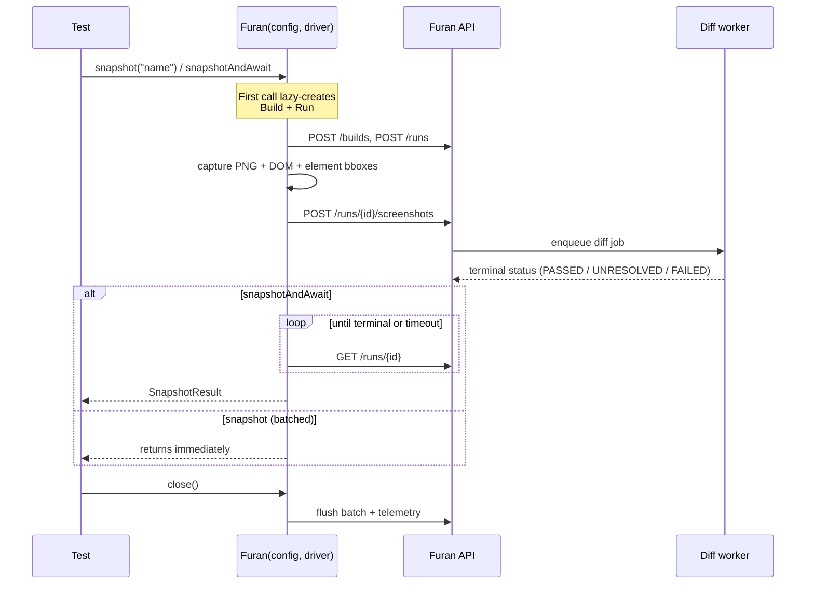

import SdkDependency from "@site/src/components/SdkDependency";

# Furan Kotlin SDK

> Visual-regression testing client for [Furan](https://github.com/qasecret/furan-monorepo) — capture screenshots in CI, diff against an approved baseline, fail the build on regressions.

[](https://central.sonatype.com/namespace/io.github.qasecret)
[](https://github.com/qasecret/furan-monorepo/blob/main/LICENSE)
[](https://adoptium.net/)

Drop-in for any JUnit 5 + Selenium, Playwright, or Appium suite. JDK 21+; Kotlin projects need Kotlin 2.3 or newer (Java projects have no Kotlin requirement). Five artifacts, pick the one matching your use case:

| Artifact                              | When to use                                           | Depends on   |
| ------------------------------------- | ----------------------------------------------------- | ------------ |
| `io.github.qasecret:furan-selenium`   | Selenium-driven tests (most common)                   | `furan-core` |
| `io.github.qasecret:furan-playwright` | Playwright-Java-driven tests                          | `furan-core` |
| `io.github.qasecret:furan-appium`     | Appium native mobile (Android / iOS) tests            | `furan-core` |
| `io.github.qasecret:furan-junit5`     | JUnit 5 `@FuranTest` annotation + parameter injection | `furan-core` |
| `io.github.qasecret:furan-core`       | Direct REST/HTTP integration without Selenium         | —            |

All capture logic lives in `furan-core` behind a driver-agnostic `SpecDriver` SPI; `furan-selenium` is the first adapter (`SeleniumSpecDriver`) and `Furan`'s public API is unchanged. New frameworks (Playwright-Java, Appium, etc.) can implement `SpecDriver` and reuse the same capture engine — scroll-and-stitch, stability polling, region resolution, DOM capture — without any Selenium dependency.

## Install

All artifacts are on Maven Central (`repositories { mavenCentral() }`).

**Selenium:**

<SdkDependency artifact="furan-selenium" />

Optional, for the `@FuranTest` annotation:

<SdkDependency artifact="furan-junit5" />

Maven:

<SdkDependency artifact="furan-selenium" format="maven" />

**Playwright** (plus `com.microsoft.playwright:playwright`, e.g. `1.64.0`):

<SdkDependency artifact="furan-playwright" />

Maven:

<SdkDependency artifact="furan-playwright" format="maven" />

**Appium (native mobile)** (plus `io.appium:java-client`, e.g. `9.5.0`):

<SdkDependency artifact="furan-appium" />

java-client 9.5.0 runs on Selenium 4.34.x, the version `furan-selenium` and
`furan-appium` bring in. If a project that uses `furan-appium` also declares a
newer Selenium, `AndroidDriver` / `IOSDriver` fail to load
(`NoClassDefFoundError: org/openqa/selenium/html5/LocationContext`).

## Quick start

```kotlin
import io.furan.sdk.FuranConfig
import io.furan.sdk.selenium.Furan
import io.furan.sdk.dto.RunStatus
import org.junit.jupiter.api.Test
import org.openqa.selenium.chrome.ChromeDriver
import kotlin.test.assertEquals

class CheckoutTest {
    @Test
    fun `homepage renders correctly`() {
        val driver = ChromeDriver()
        Furan.use(FuranConfig.fromEnv(), driver, "checkout-page") { furan ->
            driver.get("https://app.example.com/checkout")

            // Blocks until the diff worker produces a terminal status.
            val result = furan.snapshotAndAwait("checkout-page")
            assertEquals(RunStatus.PASSED, result.status)
        }
        driver.quit()
    }
}
```

Set three environment variables before running:

```bash
export FURAN_API_URL=http://localhost:8080/api      # one-file install; compose.yml: http://localhost:3000
export FURAN_API_TOKEN=furan_pat_<from-dashboard>   # Admin → API Keys, or /account/tokens
export FURAN_PROJECT_ID=<from-dashboard>            # the UUID in /projects/<id>/builds
```

`snapshotAndAwait` waits for the comparison, so on the very first run (no
baseline yet) use `snapshot` and approve the step in the dashboard first; see
[Approve your first baselines](../getting-started/first-baseline.md).

For CI, mint the token with **Access: SDK & CI** and bind it to the project in
`FURAN_PROJECT_ID`; it expires after 90 days by default. Such a token can upload
runs and, with `saveNewTests`, save the first baseline of a new test, but it
can't approve a change against an existing baseline, reach other projects, or
call admin endpoints. A refused call fails with the API's error code:
`401 token_expired`, `403 token_project_mismatch` or `403 insufficient_scope`.

## Playwright

`furan-playwright` wraps `FuranCapture` with the same open → snapshot → close
lifecycle as the Selenium adapter. `browserName` is reported as
`playwright-<type>` (`playwright-chromium`, `playwright-firefox`,
`playwright-webkit`), so the three engines each keep separate baselines against
the same page URL.

```kotlin
import com.microsoft.playwright.Playwright
import io.furan.sdk.FuranConfig
import io.furan.sdk.playwright.FuranPlaywright

Playwright.create().use { pw ->
    val browser = pw.chromium().launch()
    val page = browser.newPage()
    page.navigate("https://app.example.com/checkout")

    FuranPlaywright.use(FuranConfig.fromEnv(), page, "checkout") { furan ->
        furan.snapshot("cart")
    }

    browser.close()
}
```

`snapshotAndAwait` blocks until the diff worker produces a terminal status
(same semantics as the Selenium adapter):

```kotlin
FuranPlaywright.use(FuranConfig.fromEnv(), page, "checkout") { furan ->
    val result = furan.snapshotAndAwait("cart")
    // throws FuranAssertionException on UNRESOLVED / FAILED / ABORTED
    // unless FURAN_SOFT_ASSERT=true
}
```

See [`examples/sdk-playwright-junit5`](https://github.com/qasecret/furan-monorepo/tree/main/packages/sdk-kotlin/examples/sdk-playwright-junit5) for a
runnable JUnit 5 example.

## Appium (native mobile)

`furan-appium` wraps `FuranCapture` for **native** Android / iOS apps. It
advertises `isNative`, so the engine uses its degraded path: one full-screen
device screenshot per snapshot — no DOM, no element-map, and region selectors
are not resolved (numeric ignore / strict regions still pass through).
`browserName` is reported as `appium-<platform>` (`appium-android` /
`appium-ios`), so the platforms keep separate baselines.

```kotlin
import io.appium.java_client.AppiumDriver
import io.furan.sdk.FuranConfig
import io.furan.sdk.appium.FuranAppium
import org.openqa.selenium.remote.DesiredCapabilities
import java.net.URI

val caps = DesiredCapabilities().apply {
    setCapability("platformName", "Android")
    setCapability("appium:automationName", "UiAutomator2")
    setCapability("appium:appPackage", "com.example.app")
    setCapability("appium:appActivity", "com.example.app.MainActivity")
}
// AppiumDriver is the base type FuranAppium takes; AndroidDriver / IOSDriver work too.
val driver = AppiumDriver(URI("http://localhost:4723").toURL(), caps)

FuranAppium.use(FuranConfig.fromEnv(), driver, "checkout") { furan ->
    furan.snapshot("home")     // or snapshotAndAwait("home") to block on the diff
}

driver.quit()
```

Webview-context capture and native element → bbox region resolution are planned
follow-ups. See [`examples/sdk-appium-junit5`](https://github.com/qasecret/furan-monorepo/tree/main/packages/sdk-kotlin/examples/sdk-appium-junit5) for a
runnable JUnit 5 example.

## Driverless — raw images (any stack)

No WebDriver required. If your stack can produce a PNG — Playwright, Appium,
native mobile, `<canvas>`, server-side renders, PDFs — check it directly with
`furan-core` alone (`io.github.qasecret:furan-core`):

```kotlin
import io.furan.sdk.FuranConfig
import io.furan.sdk.images.FuranImages
import io.furan.sdk.images.ImageCheckpointOptions

val png: ByteArray = page.screenshot() // e.g. Playwright-Java; or File / BufferedImage / base64
FuranImages.use(FuranConfig.fromEnv(), testName = "checkout page") { furan ->
    furan.checkImageAndAwait(
        "checkout",
        png,
        ImageCheckpointOptions(browser = "playwright-chromium", os = "macOS 14"),
    )
}
```

`viewport` defaults to the image's pixel size; label `browser` / `os` / `device`
so different sources keep separate baselines. `checkImage(...)` uploads without
waiting; `checkImageAndAwait(...)` blocks for the verdict and throws on a
regression (unless `FURAN_SOFT_ASSERT=true`). Inputs: `ByteArray`, `File`,
`BufferedImage`, and `checkImageBase64(...)`. Selector-anchored regions are not
available (no DOM) — use numeric `Region(x, y, width, height)` coordinates.

### First run of each test needs a baseline

By default (`autoApproveFeature=false`) a project's **first run for a given test
has no baseline to diff against** — it lands as `new`, and
`snapshotAndAwait` throws **`FuranNoBaselineException`** until you turn that
first capture into the baseline. This is deliberate: the baseline is the
reference every future run is judged against, so a human gets to confirm the
first capture is correct (and mask volatile regions) before it's enshrined.
Three ways to handle it:

- **Approve in the dashboard** ("Save as baseline") — review the capture, then
  subsequent runs diff against it. The normal flow.
- **`autoApproveFeature=true`** (per-project, in project settings) — the first
  run auto-becomes the baseline with no manual step.
- **`FURAN_SOFT_ASSERT=true`** — `snapshotAndAwait` returns the `new` result
  instead of throwing, so you can tolerate first runs in CI and assert yourself.

## Lifecycle



## Configuration

| Field                 | Env var                       | Default    | Notes                                                                                                             |
| --------------------- | ----------------------------- | ---------- | ----------------------------------------------------------------------------------------------------------------- |
| **`apiUrl`**          | `FURAN_API_URL`               | —          | Required. Your Furan API endpoint.                                                                                |
| **`apiToken`**        | `FURAN_API_TOKEN`             | —          | Required. `furan_pat_*` from the dashboard.                                                                       |
| **`projectId`**       | `FURAN_PROJECT_ID`            | —          | Required. UUID from the project URL.                                                                              |
| `buildId`             | `FURAN_BUILD_ID`              | —          | Groups runs into a build. Typically `$GITHUB_RUN_ID`.                                                             |
| `branchName`          | `FURAN_BRANCH`                | `"main"`   | Branch the snapshot was captured from.                                                                            |
| `parentBranchName`    | `FURAN_PARENT_BRANCH`         | —          | Parent branch; its baseline is inherited when this branch has none. Set to the PR base (`github.base_ref`) in CI. |
| `scm.repo`            | `FURAN_REPO`                  | —          | Repository as `owner/name`, sent with each run for the GitHub App. GitHub Actions: `GITHUB_REPOSITORY`.           |
| `scm.prNumber`        | `FURAN_PR_NUMBER`             | —          | Pull request number. GitHub Actions: read from the `pull_request` event file.                                     |
| `scm.commitSha`       | `FURAN_COMMIT_SHA`            | —          | PR head commit (7 to 64 hex). GitHub Actions: the event's head commit, else `GITHUB_SHA`.                         |
| `name`                | `FURAN_BUILD_NAME`            | —          | Human-readable build label (e.g. `"nightly main"`).                                                               |
| `properties`          | `FURAN_BUILD_PROPERTIES`      | empty      | Comma-separated `key=value` pairs for filtering.                                                                  |
| `softAssert`          | `FURAN_SOFT_ASSERT`           | `false`    | If `true`, `snapshotAndAwait` returns the failed result instead of throwing.                                      |
| `pollTimeoutSeconds`  | `FURAN_POLL_TIMEOUT_SECONDS`  | `60`       | How long `snapshotAndAwait` waits for the diff worker.                                                            |
| `pollIntervalSeconds` | `FURAN_POLL_INTERVAL_SECONDS` | `1`        | Polling cadence.                                                                                                  |
| `dashboardUrl`        | `FURAN_DASHBOARD_URL`         | —          | Where `SnapshotResult.diffViewerUrl` points; usually the dashboard host.                                          |
| `viewports`           | —                             | `1280×720` | Per-test override available; multi-viewport snapshots loop internally.                                            |
| `logLevel`            | `FURAN_LOG_LEVEL`             | `"info"`   | `trace` / `debug` / `info` / `none`.                                                                              |
| `caCertPath`          | `FURAN_CA_CERT_PATH`          | —          | PEM file for custom CA (corporate-proxy / self-signed TLS).                                                       |

Four ways to build a `FuranConfig`:

```kotlin
// 1. From env vars (recommended for CI):
val config = FuranConfig.fromEnv()

// 2. From a YAML file (handy for local dev and declarative test setup):
val config = FuranConfig.fromYaml(Path.of("application.yml"))

// 3. Explicit:
val config = FuranConfig(
    apiUrl = "https://furan.acme.com",
    apiToken = System.getenv("FURAN_API_TOKEN"),
    projectId = "003f5fcf-6c5f-4f1f-a99f-82a697711382",
    branchName = "feature/payments",
    softAssert = true,
)

// 4. Copy + override (data class):
val ci = FuranConfig.fromEnv().copy(
    buildId = System.getenv("GITHUB_RUN_ID"),
    name = "nightly-main",
    properties = mapOf("region" to "us-east-1"),
)
```

### YAML

`application.yml` driven config — handy for declarative test setup:

```kotlin
val config = FuranConfig.fromYaml(Path.of("application.yml"))
```

Env vars still override every YAML entry, so CI doesn't have to rewrite the file.

## API

### `furan.snapshot(name)` — fire-and-forget

Captures and uploads in the background. Returns immediately. Use when you have **many** snapshots in one test and only want to review failures asynchronously in the dashboard.

```kotlin
furan.snapshot("homepage")
// Ignore a region by CSS selector via CheckpointOptions:
furan.snapshot("login-page", CheckpointOptions(ignoreRegions = listOf(Region.bySelector("[data-test=session-id]"))))
// Capture at a specific viewport:
furan.snapshot("settings", viewport = Viewport(1920, 1080))
```

### `furan.snapshotAndAwait(name)` — synchronous assert

Captures, uploads, and **blocks until the diff worker produces a terminal status**. Throws `FuranAssertionException` on `UNRESOLVED` / `FAILED` / `ABORTED` (unless `softAssert = true`). Throws `FuranTimeoutException` after `pollTimeoutSeconds`. Best for happy-path assertion-style tests.

```kotlin
val result = furan.snapshotAndAwait("checkout-page")
// On PASSED: result.status == RunStatus.PASSED
// result.diffViewerUrl points at the dashboard for review
```

### Per-checkpoint ignore regions

Pass `CheckpointOptions` to any `snapshot(...)`. A region is either a fixed
rectangle or a CSS selector (resolved against the captured DOM):

```kotlin
import io.furan.sdk.dto.CheckpointOptions
import io.furan.sdk.dto.Region

furan.snapshot("settings", CheckpointOptions(
    ignoreRegions = listOf(
        Region(x = 100.0, y = 50.0, width = 200.0, height = 30.0),  // a fixed rectangle
        Region.bySelector("[data-test=session-id]"),                // or a CSS selector
    ),
))
```

## JUnit 5 integration

Add `furan-junit5` and annotate your test class with `@FuranTest`. The extension auto-resolves `FuranConfig` and `FuranClient` as test-method parameters:

```kotlin
import io.furan.sdk.FuranClient
import io.furan.sdk.FuranConfig
import io.furan.sdk.junit5.FuranTest
import io.furan.sdk.selenium.Furan
import org.junit.jupiter.api.Test
import org.openqa.selenium.chrome.ChromeDriver

@FuranTest
class CheckoutTest {

    @Test
    fun `homepage`(config: FuranConfig) {
        val driver = ChromeDriver()
        Furan.use(config, driver, "homepage") { furan ->
            driver.get("https://app.example.com")
            furan.snapshotAndAwait("homepage")
        }
        driver.quit()
    }

    @Test
    fun `direct REST access`(client: FuranClient) {
        // Lower-level — no Selenium, drives the API directly.
        // client.createBuild(...), client.snapshotAndAwait(...)
    }
}
```

The extension caches one `FuranConfig` per test class and shares it across `@Test` methods.

## Examples

| Example                                                                                                                                     | Description                                                                                                              |
| ------------------------------------------------------------------------------------------------------------------------------------------- | ------------------------------------------------------------------------------------------------------------------------ |
| [`examples/sdk-selenium-junit5`](https://github.com/qasecret/furan-monorepo/tree/main/packages/sdk-kotlin/examples/sdk-selenium-junit5)     | Standalone Gradle project — copy-paste-runnable JUnit 5 + Selenium + ChromeDriver.                                       |
| [`examples/sdk-playwright-junit5`](https://github.com/qasecret/furan-monorepo/tree/main/packages/sdk-kotlin/examples/sdk-playwright-junit5) | Standalone Gradle project — copy-paste-runnable JUnit 5 + Playwright-Java. Gated by `FURAN_API_URL`.                     |
| [`examples/sdk-appium-junit5`](https://github.com/qasecret/furan-monorepo/tree/main/packages/sdk-kotlin/examples/sdk-appium-junit5)         | Standalone Gradle project — JUnit 5 + Appium (native mobile). Gated by `FURAN_API_URL`; needs an Appium server + device. |
| [`docs/integrations/github-actions.md`](../integrations/github-actions.md)                                                                  | GitHub Actions workflow with PR comments + branch baselines.                                                             |

## Versioning

The SDK is published from `main` via [release-please](https://github.com/googleapis/release-please) on Conventional Commits. The current `version.txt` is the single source of truth — all artifacts (`core`, `selenium`, `playwright`, `appium`, `junit5`) always share the same version.

Semantic versioning — breaking changes land only on major bumps: v2.0.0 (explicit lifecycle), v3.0.0 (the `SpecDriver` SPI), and **v4.0.0** (removes the dormant v2-runtime preview API — see below).

### Migrating to 4.0

4.0 removes the dormant, never-wired **v2 runtime** preview API from `furan-core`:
the `io.furan.sdk.runtime`, `event`, `endpoint`, `plugin`, `diagnostics`, and
`http` packages. They never participated in the snapshot/capture path, so the
adapters (`Furan` / `FuranPlaywright` / `FuranAppium` / `FuranImages`),
`FuranConfig`, and `FuranClient` are unchanged — upgrading is a no-op for normal
use. Remove any direct `io.furan.sdk.runtime.*` (etc.) imports if you had them.

## Support

- **Issues:** [github.com/qasecret/furan-monorepo/issues](https://github.com/qasecret/furan-monorepo/issues)
- **Server docs:** [Getting started](../getting-started/install.md) covers self-hosting and the first upload.
- **API reference:** `GET /openapi.json` on your deployment, or interactive docs at `GET /docs`.

## License

Apache 2.0 — see [`LICENSE`](https://github.com/qasecret/furan-monorepo/blob/main/LICENSE).
